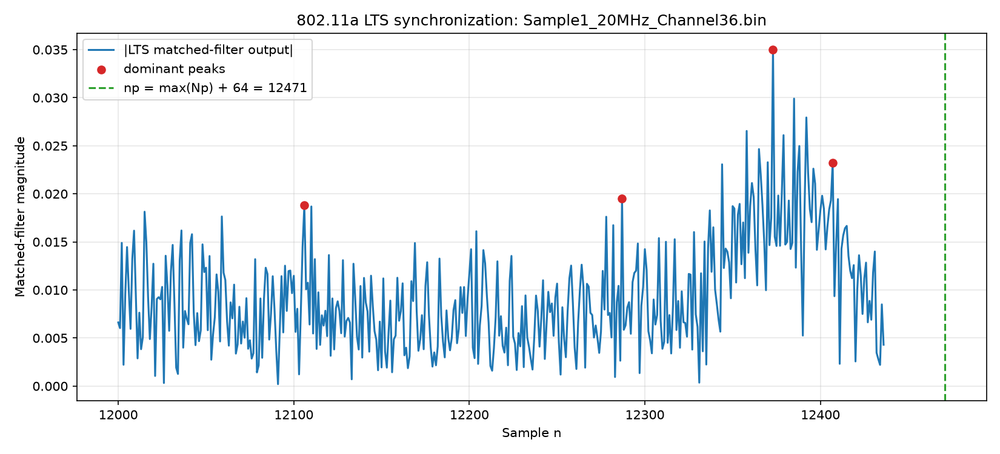

# OFDM Sync Long: alinhamento de símbolos

Esta página documenta a Secção 2.4 (Symbol Alignment) do artigo e responde
às cinco perguntas da Week 4. A Figura 3 foi gerada por
[`scripts/plot_sync_long.py`](../scripts/plot_sync_long.py).



O gráfico mostra os dois picos principais da correlação, correspondentes a T1
e T2, separados exatamente por 64 amostras. Entre o início do preâmbulo longo
e T1 existe o GI2 de 32 amostras; a estrutura completa é, portanto,
`GI2 (32) + T1 (64) + T2 (64) = 160` amostras.

## 1. How is symbol alignment done (algorithm logic)?

O Sync Long recebe a sequência depois da deteção do preâmbulo curto. Na fase
`SYNC`, [`sync_long.cc`](../gr-ieee802-11/lib/sync_long.cc) aplica um filtro
adaptado ao LTS conhecido de 64 amostras e guarda cada saída juntamente com o
seu índice (`d_cor`). O preâmbulo longo tem a estrutura:

```text
GI2 (32 amostras) + T1 (64 amostras) + T2 (64 amostras) = 160 amostras
```

Uma janela alinhada com T1 ou T2 soma coerentemente os produtos com o LTS e
produz um pico agudo. Em `search_frame_start()`, as correlações são ordenadas
por magnitude (`d_cor.sort(compare_abs)`), os quatro candidatos mais fortes são
comparados e o algoritmo procura dois picos separados por 64 amostras
(aceitando também 63 ou 65 para tolerar uma pequena imperfeição de relógio).
Quando encontra a separação exata, grava a posição mais antiga em
`d_frame_start` e estima o CFO pela diferença de fase dos dois picos:

```cpp
if (diff == 64) {
    d_frame_start = min(get<1>(vec[i]), get<1>(vec[k]));
    d_freq_offset = arg(first * conj(second)) / 64;
    return;
}
```

No estado `COPY`, os primeiros 128 samples relativos a `d_frame_start`
correspondem às duas partes úteis de 64 amostras do LTS. Depois, cada símbolo
de dados é tratado como uma janela de 80 amostras (16 de prefixo cíclico +
64 úteis); a condição `((rel - 128) % 80) > 15` elimina os 16 samples de GI de
cada símbolo. Assim, a saída começa na fronteira correta para a FFT.

## 2. Why is matched filtering used for symbol alignment but not for frame detection?

Para deteção contínua da trama, o `sync_short` usa a autocorrelação entre
amostras separadas por 16 samples. As repetições periódicas do Sync Short
criam um **patamar largo (plateau)**: é uma métrica leve para executar
continuamente e robusta mesmo com CFO elevado, mas não identifica a fronteira
com precisão de uma amostra. Essa precisão não é necessária para decidir
apenas se existe uma trama.

Para o alinhamento, o Sync Long usa o filtro adaptado FIR de 64 amostras. A
correlação com a forma completa do LTS transforma o plateau numa sequência de
**picos impulsivos e agudos**, adequados para escolher a posição exata da
janela FFT. O custo é maior (64 produtos complexos e uma acumulação por
posição), por isso `d_fir.filterN(...)` só é executado numa janela curta
`SYNC_LENGTH`, depois de o Sync Short já ter detetado a trama, e não durante
todo o fluxo.

## 3. Have a look at the code that implements equation 6.

A Equação 6 do artigo é a correlação de uma janela recebida `r` com o LTS
conjugado:

```text
y[n] = sum(k=0..63) r[n+k] conj(LTS[k])
```

Ela é implementada no construtor pela criação do FIR com os coeficientes
`LONG` e, no estado `SYNC`, por:

```cpp
d_fir.filterN(
    d_correlation, in,
    std::min(SYNC_LENGTH, std::max(ninput - 63, 0)));
```

`LONG` é o vetor de 64 amostras complexas do LTS. A rotina FIR aplica a
convenção de convolução do GNU Radio (que pode inverter a ordem dos
coeficientes); isso é a mesma correlação da Equação 6, desde que se considere
essa convenção de índices. O valor produzido em `d_correlation[i]` é depois
associado a `d_offset` e usado por `search_frame_start()` para selecionar os
picos.

## 4. Why do you add 64 in expression 7?

Na definição da Equação 6, `y[n]` usa `r[n+k]`, com `k = 0..63`. Logo, o
índice `n` referencia o início da janela de 64 amostras sob teste, e não o
seu fim. Na notação da Equação 7, o primeiro pico `min(Np)` marca o início de
T1 e o segundo pico `max(Np)` marca o início de T2. Como T2 dura 64 amostras:

```text
np = max(Np) + 64
```

soma-se 64 para avançar desde o início de T2 até ao seu fim. Assim, `np` fica
na fronteira exata onde termina o LTS e começa o primeiro símbolo OFDM de 80
amostras, o campo SIGNAL, seguido dos símbolos de dados. O `+64` não é um
atraso arbitrário do filtro: é a duração de T2 e também a dimensão da FFT.

No código, os dois picos são separados por 64 e `search_frame_start()` guarda
a posição mais antiga em `d_frame_start`. Portanto, `d_frame_start` é a
posição de arranque do LTS (T1), não a fronteira de dados. No estado `COPY`,
o bloco envia primeiro os 128 samples de T1 + T2 (`rel < 128`) para a FFT,
permitindo ao equalizador estimar o canal. Só a partir de `rel >= 128` é que
remove os 16 samples de prefixo cíclico de cada símbolo de 80 amostras; esta
origem no início de T1 é equivalente à fronteira `np = max(Np) + 64` da
notação do artigo.

## 5. What does the stream to vector block do?

Depois de o Sync Long remover os 16 samples de prefixo cíclico de cada
símbolo de 80 samples, restam exatamente 64 samples consecutivos por
símbolo. O bloco **Stream to Vector (64)** agrupa esse fluxo série em vetores
paralelos de 64 amostras. Cada vetor é então a entrada de uma FFT de 64
pontos; assim, a FFT não recebe o GI e opera apenas no intervalo útil do
símbolo.
